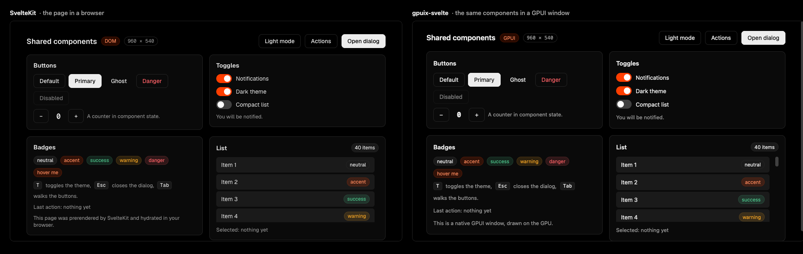

# gpuix-svelte + SvelteKit: shared components demo

One small component library, rendered two ways: as a SvelteKit site in the browser, and as a native
desktop window through [gpuix-svelte](https://github.com/khromov/gpuix-svelte), which renders Svelte
on GPUI, the UI framework behind Zed. Same `.svelte` files, same props, same styles.



Left: the SvelteKit page in a browser. Right: the same components in a GPUI window.

## Try it

You need Node 24 or newer and a checkout of gpuix-svelte next to this folder. gpuix-svelte's DOM
side and its accessibility fixes are not released yet, so this project depends on
`file:../gpuix-svelte` and on its `fix/a11y-plain-text` branch
([#74](https://github.com/khromov/gpuix-svelte/pull/74)); drop the `-b` once that has merged. The
window needs macOS or Windows.

```bash
git clone -b fix/a11y-plain-text https://github.com/khromov/gpuix-svelte ../gpuix-svelte
(cd ../gpuix-svelte && bun install)
npm install
npm run dev
```

`npm run dev` opens the site in your browser and the GPUI window next to it, both hot-reloading.
Press `T` in either to switch the theme. `npm run dev:web` or `npm run dev:gpuix` starts one side,
`npm run build` prerenders the site into `build/`, and `npm run check:all` typechecks both sides.
`npm test` runs both test suites: `test:dom` mounts the Showcase in happy-dom under Vitest, and
`test:gpuix` clicks through the window headlessly. Each one also checks what a screen reader gets
and what the keyboard alone can do.

## How it is put together

- `src/lib/components/` is the library: Button, Badge, Card, Toggle and Kbd. `src/lib/Showcase.svelte`
  puts them all on one screen, together with the Scroller, Tooltip, Popover and Portal that
  gpuix-svelte ships.
- `src/routes/` is the SvelteKit side, prerendered with adapter-static. `app.ts` and
  `src/GpuixSvelteApp.svelte` are the desktop side, started through gpuix-svelte's launcher.
- `src/lib/theme.svelte.ts` holds the palette; one `set_css_vars` call applies it on both renderers.

The trick is in gpuix-svelte's package exports. Without the `custom-renderer` condition, which only
its desktop tooling sets, `gpuix-svelte` resolves to the DOM build of the package and its components to
DOM versions, so SvelteKit gets the browser side with no configuration. `IS_GPUIX` tells a component
which side it is on. The components use it for two attributes that GPUI needs and the DOM does not
have: `hitbox="self"` (`src/lib/gpui.ts`), and the `motion` that slides the Toggle's knob, since GPUI
ignores CSS `transition`.

## Writing components that work on both

Stick to what both renderers draw the same way: `div`s, flexbox, class rules with `:hover`, colours as
`var(--token)`, lengths with units. No `bind:`, no DOM-only elements, no GPUI-only attributes. Two
typechecks keep you honest: `npm run check` types the markup as DOM, `npm run check:gpuix` as GPUI,
and the shared components have to pass both. The full set of rules is in gpuix-svelte's
[docs](https://github.com/khromov/gpuix-svelte/blob/main/docs/dom.md).

Each component spreads the props it does not use itself onto its root `div`, typed with `DivProps` from
`src/lib/gpui.ts`. The div's attributes come from `#attributes`, which resolves on the same
`custom-renderer` condition as gpuix-svelte, so each typecheck sees its own renderer's div: `title`
passes the DOM check and fails the GPUI one, `testid` the reverse, and only what suits both passes both.

Fonts and scrollbars differ between a browser and GPUI, so the two never match to the pixel.
Everything else does.

## Accessibility

`role` and the `aria-*` attributes GPUI knows reach VoiceOver and other screen readers on both sides,
so the components use them: Button is a `button`, Toggle a `switch`, Card titles are headings, the
list is a `listbox` of `option`s and the dialog a `dialog`. The keyboard alone works too. Arrow keys
walk the menu and the list, the dialog keeps Tab inside it, and a menu or dialog gives focus back to
the button that opened it when it closes. Svelte's a11y warnings are on, so both typechecks report
any regression.

GPUI's accessibility tree has no `aria-checked`, `aria-disabled`, `aria-modal`, `aria-haspopup`
or `aria-keyshortcuts` yet, so `dom_aria()` in `src/lib/gpui.ts` gives those to the browser only.
In the window, a switch reports `on` or `off` as its value instead, and a disabled button is
announced like an enabled one. Visible text reaches a screen reader in the window from gpuix-svelte's
fix for plain text ([#74](https://github.com/khromov/gpuix-svelte/pull/74)) onward; before it,
VoiceOver hears the controls but none of the text. That PR also adds an accessibility page to
gpuix-svelte's docs with every attribute GPUI lacks and what to use instead.
